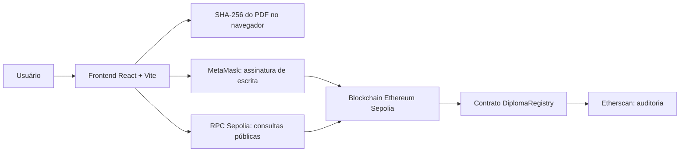

# AcadChain — Registro Acadêmico Blockchain

   

> **Projeto acadêmico de demonstração.** Os diplomas utilizados nos testes são fictícios. A rede Sepolia utiliza ETH de teste e não constitui uma infraestrutura oficial de emissão de diplomas.

## 1. Visão geral

O **AcadChain** é uma aplicação Web3 para registrar, consultar e revogar certificados ou diplomas acadêmicos em um contrato inteligente na rede de testes Ethereum Sepolia. A aplicação também permite obter o **SHA-256 de um arquivo PDF**, registrá-lo como identificador on-chain e, posteriormente, verificar se o mesmo arquivo corresponde ao registro.

O conteúdo do PDF **não é armazenado na blockchain**. Apenas um hash de 32 bytes é enviado ao contrato, junto com os metadados informados no cadastro. A autenticidade exibida pelo sistema significa que existe um registro não revogado para aquele hash, emitido por uma carteira autorizada; **não comprova, por si só, a legitimidade acadêmica de uma instituição**.

## 2. Funcionalidades

- Conexão com **MetaMask** na rede Sepolia.
- Controle de emissores autorizados pelo contrato inteligente.
- Emissão de registros acadêmicos com aluno, curso, instituição e identificador.
- Geração local de **SHA-256** para arquivos PDF selecionados no navegador.
- Consulta pública de registros, sem necessidade de conectar carteira.
- Verificação da validade de um registro e exibição de seu estado: **autêntico** ou **revogado**.
- Revogação de registros por carteiras com permissão, respeitando as regras do contrato.
- Consulta a transações e ao contrato no **Sepolia Etherscan**.

### Dois modos de identificador

O frontend oferece dois caminhos:

1. **Identificador textual:** converte um texto, por exemplo `DIPLOMA-TESTE-001`, em `bytes32` usando `ethers.id()` (Keccak-256 do texto).
2. **Arquivo PDF:** calcula SHA-256 dos bytes exatos do arquivo e utiliza o resultado hexadecimal (`0x` + 64 caracteres) como `bytes32`.

**Atenção:** quando um PDF é selecionado durante a emissão, o **hash do PDF prevalece** sobre o identificador textual digitado. Para consultar esse registro posteriormente, use o mesmo arquivo PDF ou seu hash SHA-256. O identificador textual exibido no formulário **não é gravado como chave adicional**.

Modificar ou salvar novamente um PDF pode alterar seus bytes e, portanto, seu hash, mesmo quando a mudança visual for pequena. Um arquivo modificado normalmente aparecerá como **não encontrado**, e não como “fraude comprovada”.

## 3. Tecnologias

| Camada                               | Tecnologias                    |
| ------------------------------------ | ------------------------------ |
| Contrato inteligente                 | Solidity 0.8.x                 |
| Desenvolvimento e testes do contrato | Hardhat, ethers.js             |
| Frontend                             | React, Vite, CSS, lucide-react |
| Integração blockchain                | ethers.js e MetaMask           |
| Blockchain de testes                 | Ethereum Sepolia               |
| Exploração das transações            | Sepolia Etherscan              |
| Inspeção e demonstração Solidity     | Remix IDE                      |
| Design de interface                  | Figma                          |

## 4. Arquitetura



A MetaMask assina operações que alteram o estado do contrato. Consultas de leitura podem ser feitas pelo RPC público, sem solicitar assinatura. **O arquivo PDF permanece no dispositivo do usuário** no fluxo implementado; seu hash é calculado no navegador.

## 5. Contrato implantado

- **Rede:** Ethereum Sepolia
- **Chain ID decimal:** `11155111`
- **Chain ID hexadecimal:** `0xaa36a7`
- **Endereço do contrato:** `0xe29433e3a1b94F5f745443A120F449f7E10317cB`
- **Explorador:** https://sepolia.etherscan.io/address/0xe29433e3a1b94F5f745443A120F449f7E10317cB
- **Carteira proprietária utilizada nos testes (endereço público):** `0xDA772b6c07369D9Bd08714E3640F3149d94330c8`

> O endereço de uma carteira Ethereum é público. **Jamais publique a chave privada ou a frase de recuperação.**

### Recursos principais do `DiplomaRegistry.sol`

| Elemento                                 | Papel                                                          |
| ---------------------------------------- | -------------------------------------------------------------- |
| `struct Diploma`                         | Armazena os metadados e estados do registro.                   |
| `mapping`                                | Relaciona hashes a registros e gerencia emissores autorizados. |
| `constructor`                            | Inicializa proprietário e autorização inicial.                 |
| `modifier`                               | Restringe operações administrativas e de emissão.              |
| `require`                                | Valida precondições, permissões e estado do diploma.           |
| `registrarDiploma(...)`                  | Grava um novo diploma utilizando um hash único.                |
| `consultarDiploma(...)`                  | Retorna os dados do diploma existente.                         |
| `verificarAutenticidade(...)`            | Indica se existe e não foi revogado.                           |
| `revogarDiploma(...)`                    | Revoga um diploma de acordo com as permissões do contrato.     |
| `totalDiplomas()` e `hashPorIndice(...)` | Permitem enumerar os hashes registrados.                       |

## 6. Estrutura do projeto

```text
projeto-sepolia/
├── contracts/
│   └── DiplomaRegistry.sol
├── scripts/
│   ├── deploy.js
│   ├── testar.js
│   └── revogar.js
├── frontend/
│   ├── src/
│   │   ├── App.jsx
│   │   ├── App.css
│   │   └── index.css
│   ├── .env.example
│   ├── package.json
│   └── ...
├── hardhat.config.js
├── package.json
├── .env.example
├── .gitignore
└── README.md
```

> A árvore apresenta a **organização recomendada**. Confirme quais arquivos existem na sua cópia local antes de publicar; não é necessário publicar `node_modules/`, `artifacts/` ou `cache/`.

## 7. Requisitos de execução

- Node.js e npm compatíveis com as versões instaladas no projeto.
- Navegador moderno.
- Extensão MetaMask para operações de escrita.
- Carteira configurada na rede Sepolia e **ETH de teste** para transações.

### 7.1. Contrato / Hardhat

Na raiz do repositório:

```bash
npm install
npx hardhat compile
```

Para executar scripts já existentes na Sepolia:

```bash
npx hardhat run scripts/testar.js --network sepolia
```

**Cuidado:** scripts de teste podem criar transações reais na Sepolia e gastar ETH de teste. O script `revogar.js` realiza revogação de um registro de teste; use apenas quando quiser executar esse procedimento. O contrato existente **não precisa de novo deploy** para usar o frontend.

### 7.2. Frontend / React

```bash
cd frontend
npm install
npm run dev
```

Abra a URL local mostrada no terminal, normalmente `http://localhost:5173/`.

## 8. Configuração de ambiente

Existem **dois ambientes separados**. O arquivo `.env` da raiz não é o mesmo arquivo `.env` do frontend.

### 8.1. `.env` da raiz (Hardhat — privado)

Exemplo de `.env.example`:

```dotenv
SEPOLIA_RPC_URL=https://ethereum-sepolia-rpc.publicnode.com
PRIVATE_KEY=INSIRA_SOMENTE_NO_SEU_ENV_LOCAL
```

A chave privada deve ficar **somente** no `.env` local da raiz, nunca no README, no frontend ou em arquivos enviados ao Git.

### 8.2. Configurações públicas do frontend (React + Vite)

O frontend utiliza três constantes públicas definidas diretamente no arquivo `frontend/src/App.jsx`:

```javascript
const ADDRESS = "0xe29433e3a1b94F5f745443A120F449f7E10317cB";
const RPC = "https://ethereum-sepolia-rpc.publicnode.com";
const CHAIN_ID = "0xaa36a7";
```

Essas constantes representam, respectivamente, o endereço do contrato inteligente, o servidor RPC público da rede Sepolia e o identificador da rede Ethereum Sepolia.

Como essas informações são públicas, não é necessário criar um arquivo `.env` específico para o frontend.

As operações que exigem autorização são assinadas pela MetaMask, sem expor a chave privada da carteira ao código React.

O arquivo `.env` da raiz do projeto continua sendo utilizado pelo Hardhat para armazenar configurações privadas e deve permanecer protegido pelo `.gitignore`.

### 8.3. Proteção contra publicação acidental

Certifique-se de que o `.gitignore` **da raiz do repositório** inclui ao menos:

```gitignore
node_modules/
frontend/node_modules/
.env
.env.*
!.env.example
**/.env
**/.env.*
!**/.env.example
artifacts/
cache/
coverage/
frontend/dist/
```

Antes de enviar para o GitHub, confira os arquivos que serão versionados:

```bash
git status --short
# Se o repositório já tiver Git inicializado:
git ls-files | grep -E '(^|/)\.env($|\.)'
```

Se um segredo **já tiver sido commitado**, adicioná-lo ao `.gitignore` não o remove do histórico: é necessário revogar/rotacionar a credencial e tratar o histórico de Git adequadamente.

## 9. Fluxos de utilização

### 9.1. Consultar diploma pelo identificador

1. Abra **Consultar diploma**.
2. Informe um identificador textual conhecido, como `DIPLOMA-TESTE-001`.
3. Clique em **Verificar diploma**.
4. Observe os dados e o estado da verificação.

### 9.2. Emitir diploma com PDF

1. Conecte a MetaMask à Sepolia com uma carteira autorizada.
2. Abra **Emitir diploma**.
3. Preencha aluno, curso e instituição.
4. Escolha um identificador textual para referência de interface (quando houver PDF selecionado, a chave blockchain será o SHA-256 do PDF).
5. Selecione o arquivo PDF e confira o SHA-256 exibido.
6. Confirme a transação na MetaMask.
7. Aguarde a confirmação e guarde o link da transação no Etherscan.

### 9.3. Verificar PDF registrado

1. Abra **Consultar diploma** (MetaMask não é obrigatória para leitura).
2. Selecione exatamente o PDF registrado.
3. Aguarde a geração do SHA-256.
4. Clique em **Verificar diploma**.
5. Se o registro existir e estiver válido, será exibido **Autêntico**.

### 9.4. Revogar diploma

1. Conecte a carteira autorizada à Sepolia.
2. Abra **Revogar diploma**.
3. Informe o identificador textual ou cole o hash `0x...` utilizado na emissão.
4. Consulte o registro e confirme a revogação pela MetaMask.
5. Consulte novamente e verifique que seu estado mudou para **Revogado**.

A revogação é permanente no contrato atual. Evite revogar registros que você pretende manter válidos na demonstração.

## 10. Testes executados

Os testes a seguir foram realizados durante o desenvolvimento:

| Teste                                         | Resultado relatado |
| --------------------------------------------- | ------------------ |
| Hardhat: autorização do emissor               | Aprovado           |
| Hardhat: registro de diploma fictício         | Aprovado           |
| Hardhat: consulta e autenticidade             | Aprovado           |
| Hardhat: revogação                            | Aprovado           |
| Remix IDE: compilação e consultas do contrato | Aprovado           |
| React: consulta de diploma revogado           | Aprovado           |
| MetaMask: conexão de carteira autorizada      | Aprovado           |
| React: registro de PDF por SHA-256 na Sepolia | Aprovado           |
| React: consulta do PDF original               | Autêntico          |
| React: consulta do PDF modificado             | Não encontrado     |

### 10.1. Registros de teste — evidências já identificadas

**Registro do diploma textual de teste (`DIPLOMA-TESTE-001`):**

- Transação: `0xcd2802c13a597a6f9564afa4bb01ba0eb98ec6916223137f532731d471f33658`
- Gas utilizado: `798082` unidades.
- Etherscan: https://sepolia.etherscan.io/tx/0xcd2802c13a597a6f9564afa4bb01ba0eb98ec6916223137f532731d471f33658

**Revogação do mesmo registro:**

- Transação: `0x4f96365d17f94c416a7d2a5a624bdd65b96ed2faaf46f7c1662c8431d8acb13a`
- Gas utilizado: `32867` unidades.
- Etherscan: https://sepolia.etherscan.io/tx/0x4f96365d17f94c416a7d2a5a624bdd65b96ed2faaf46f7c1662c8431d8acb13a

**Primeiro PDF de teste:**

- Nome: `diploma_teste_acadchain.pdf`.
- SHA-256: `0x2c2089333836cce2106c8349df1ac4844d5199abe602a04c7222514457159a1f`.
- O usuário confirmou que o registro no frontend foi concluído e que a consulta ao PDF original retornou **Autêntico**.
- O identificador da transação desse registro PDF ainda deve ser acrescentado à documentação quando obtido.

> **Importante:** os números de gás acima se referem ao _registro_ e à _revogação_ de teste. O trabalho acadêmico solicita **também o gás do deploy**; esse custo ainda precisa ser coletado a partir da transação de implantação.

## 11. Plano para a demonstração final

Para organizar uma entrega reproduzível, a etapa final utilizará **novos diplomas fictícios**, preservando o contrato já implantado:

- [ ] Criar um novo PDF original com dados fictícios.
- [ ] Criar uma versão modificada do mesmo PDF.
- [ ] Registrar o novo PDF pela interface Web3 com a MetaMask.
- [ ] Consultar o original e capturar o estado **Autêntico**.
- [ ] Consultar o modificado e capturar o estado **Não encontrado**.
- [ ] Revogar o novo registro e capturar o estado **Revogado**.
- [ ] Registrar os links das transações correspondentes.
- [ ] Capturar telas do Remix IDE, MetaMask, React e Etherscan.
- [ ] Obter a transação de deploy e seu custo de gás.
- [ ] Elaborar o relatório técnico (máximo de 10 páginas).
- [ ] Revisar e organizar o repositório antes da publicação.

## 12. Entregáveis acadêmicos

De acordo com o enunciado da avaliação prática:

1. **Smart contract Solidity** funcional, comentado e organizado.
2. **Deploy real em testnet**, informando endereço e link Etherscan.
3. **Interface Web3**, com conexão de carteira e pelo menos duas funções do contrato.
4. **Relatório técnico PDF de até 10 páginas**, contendo introdução, arquitetura, principais funções, custo de gás do deploy, testes com capturas e resultados, e melhorias futuras.

O projeto selecionado é a **Opção C — Registro Acadêmico Blockchain**, cujos requisitos específicos incluem registro, consulta pública, hash de arquivos e frontend Web3.

### Organização sugerida dos materiais de entrega

```text
entrega/
├── README.md
├── codigo-fonte/              # Ou link para o repositório organizado
├── evidencias/
│   ├── remix-compilacao.png
│   ├── metamask-conexao.png
│   ├── emissao-frontend.png
│   ├── consulta-autentico.png
│   ├── consulta-modificado.png
│   ├── revogacao.png
│   └── etherscan-transacoes.png
├── diplomas-teste/
│   ├── diploma-original.pdf
│   └── diploma-modificado.pdf
└── relatorio-tecnico-acadchain.pdf
```

A estrutura acima é uma **recomendação**, não um formato de compactação imposto pelo enunciado. Confirme no ambiente da disciplina se o professor quer ZIP, repositório GitHub ou envio separado.

## 13. Limitações e melhorias futuras

- O contrato guarda metadados básicos e um hash; ele não consulta registros oficiais de instituições de ensino.
- Não há hospedagem descentralizada do PDF nem mecanismos de recuperação do arquivo.
- Um PDF com conteúdo visualmente equivalente, mas bytes diferentes, gera outro hash.
- É recomendável melhorar as mensagens de erro para registros não encontrados e tratamento de falhas de RPC.
- O frontend poderia atualizar automaticamente o estado quando o usuário troca de conta/rede na MetaMask.
- Melhorias futuras possíveis: gestão de instituições emissoras, pesquisa por curso/aluno com proteção de dados, QR Code de verificação, histórico de eventos, testes automatizados abrangentes e publicação da interface.

## 14. Segurança e privacidade

- **Nunca** envie a chave privada do Hardhat nem a frase de recuperação da MetaMask ao GitHub.
- O frontend recebe apenas configurações **públicas** via `VITE_*`.
- Usar a Sepolia evita gastar ETH real nos testes, mas transações ainda consomem ETH de teste.
- Evite registrar nomes reais, números de matrícula ou outros dados pessoais sensíveis em contratos públicos: informações on-chain são públicas e, em geral, imutáveis.
- Use documentos **fictícios** nos testes e marque-os como sem validade acadêmica.
- Apenas o hash não é prova suficiente de legitimidade institucional: a confiança depende das regras e da governança das carteiras emissoras.

## 15. Design

Interface de referência no Figma: https://www.figma.com/design/FyD5T98UUOTtInaC1Clx0O

---

**AcadChain — projeto acadêmico Web3 em ambiente de testes.**
