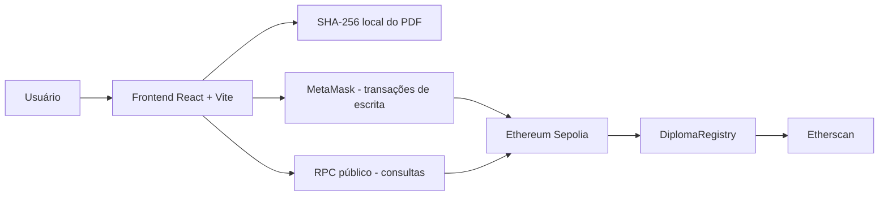

# AcadChain — Registro Acadêmico Blockchain

   

> **Projeto acadêmico demonstrativo.** Todos os diplomas utilizados nos testes são fictícios e não possuem validade acadêmica ou jurídica. A Sepolia é uma rede de testes que utiliza ETH de teste.

## Visão geral

O **AcadChain** é uma aplicação Web3 para registrar, consultar, verificar a autenticidade e revogar registros acadêmicos por meio de um contrato inteligente na blockchain **Ethereum Sepolia**. O frontend em **React** integra-se à **MetaMask** e permite verificar documentos PDF por meio de seu **hash SHA-256**.

O arquivo PDF **não é enviado nem armazenado na blockchain**. O navegador calcula seu hash, que é utilizado como chave `bytes32` no contrato, juntamente com os metadados do diploma. A classificação *autêntico* significa apenas que há um registro não revogado para o hash, criado por um emissor autorizado; isso **não constitui validação oficial de uma instituição de ensino**.

## Funcionalidades

- Conectar uma carteira MetaMask na rede Sepolia.
- Registrar diplomas fictícios por uma carteira autorizada.
- Calcular o SHA-256 de arquivos PDF localmente no navegador.
- Consultar registros publicamente, sem conectar uma carteira.
- Verificar se o registro está ativo ou revogado.
- Identificar arquivos alterados pela divergência entre seus hashes.
- Revogar registros por uma carteira com permissão.
- Inspecionar contratos e transações no Etherscan e no Remix IDE.

### Identificadores e integridade

O frontend aceita dois modos de identificação:

1. **Texto:** o identificador é transformado em `bytes32` por `ethers.id()` (Keccak-256).
2. **PDF:** o navegador calcula o SHA-256 dos bytes do documento, utilizando `0x` seguido de 64 caracteres hexadecimais como identificador.

**Importante:** quando um PDF é selecionado na emissão, o **hash do arquivo prevalece** sobre o identificador textual. A alteração dos bytes de um PDF modifica seu hash; se a nova versão não tiver registro, será exibida como **não encontrada**. Isso, isoladamente, não comprova fraude.

## Tecnologias

| Camada | Tecnologias |
|---|---|
| Contrato inteligente | Solidity 0.8.x |
| Desenvolvimento e testes | Hardhat, ethers.js |
| Interface web | React, Vite, CSS, lucide-react |
| Carteira Web3 | MetaMask |
| Rede de testes | Ethereum Sepolia |
| Explorador blockchain | Sepolia Etherscan |
| Compilação e consultas adicionais | Remix IDE |
| Protótipos de interface | Figma |

## Arquitetura



A MetaMask assina transações que alteram o estado do contrato. Consultas públicas são feitas por RPC, sem assinatura. O processamento do PDF ocorre localmente no navegador.

## Contrato implantado

| Informação | Valor |
|---|---|
| Rede | Ethereum Sepolia |
| Chain ID | `11155111` (`0xaa36a7`) |
| Contrato | `0xe29433e3a1b94F5f745443A120F449f7E10317cB` |
| Implantação | 15/10/2026 |
| Status do deploy | Sucesso |

- [Visualizar contrato no Sepolia Etherscan](https://sepolia.etherscan.io/address/0xe29433e3a1b94F5f745443A120F449f7E10317cB)
- [Visualizar transação de implantação](https://sepolia.etherscan.io/tx/0xded683b711338f731785b06180852ecf45589fd673c2dbb52576d999f7e0757c)

### Custo da implantação

| Métrica | Valor |
|---|---:|
| Gas limit | 13.255.648 |
| Gas used | **13.150.115** |
| Porcentagem do limite utilizada | 99,2% |
| Gas price efetivo | 1 Gwei |
| Transaction fee | **0,013150115 ETH de teste** |

A taxa corresponde a `13.150.115 × 1 Gwei = 0,013150115 ETH`. Não houve pagamento em ETH da rede principal.

### Contrato Solidity

O contrato `contracts/DiplomaRegistry.sol` inclui `struct`, `mapping`, `modifier`, `require` e `constructor`. Suas operações principais são:

| Função | Finalidade |
|---|---|
| `registrarDiploma(...)` | Registrar diploma por emissor autorizado |
| `consultarDiploma(bytes32)` | Consultar os metadados do registro |
| `verificarAutenticidade(bytes32)` | Conferir existência e ausência de revogação |
| `revogarDiploma(bytes32)` | Revogar um registro |
| `totalDiplomas()` | Retornar a quantidade de registros |
| `hashPorIndice(uint256)` | Consultar hashes registrados por índice |

## Como executar localmente

### Requisitos

- Node.js e npm compatíveis com o projeto.
- Navegador moderno.
- MetaMask configurada na Sepolia para emissão e revogação.
- ETH de teste na carteira autorizada para operações de escrita.

### Compilar o contrato

Na raiz do repositório:

```bash
npm install
npx hardhat compile
```

> O contrato **já está implantado**; não é necessário realizar outro deploy para usar o frontend.

### Executar o frontend

```bash
cd frontend
npm install
npm run dev
```

Abra o endereço apresentado no terminal, normalmente `http://localhost:5173/`.

### Configuração

O Hardhat usa o arquivo `.env` **privado** na raiz, com as variáveis:

```dotenv
SEPOLIA_RPC_URL=https://ethereum-sepolia-rpc.publicnode.com
PRIVATE_KEY=CONFIGURE_APENAS_LOCALMENTE
```

Não publique o `.env` nem inclua chaves privadas no código, README ou frontend. O frontend utiliza constantes **públicas** em `frontend/src/App.jsx`:

```js
const ADDRESS = "0xe29433e3a1b94F5f745443A120F449f7E10317cB";
const RPC = "https://ethereum-sepolia-rpc.publicnode.com";
const CHAIN_ID = "0xaa36a7";
```

Não é necessário criar um `.env` específico para o frontend na configuração atual.

## Como utilizar

1. **Consultar diploma:** informe um identificador textual ou selecione o mesmo PDF registrado e clique em verificar; a consulta não exige MetaMask.
2. **Registrar diploma:** conecte uma carteira autorizada na Sepolia, preencha aluno, curso e instituição, selecione o PDF e confirme a transação na MetaMask.
3. **Verificar integridade:** consulte o PDF original e depois uma versão modificada; a alteração gera outro hash, que poderá não ter registro.
4. **Revogar diploma:** conecte a carteira autorizada, informe o hash ou identificador utilizado no registro e confirme a revogação. O registro permanece consultável, mas perde a validade no contrato.

## Testes e resultados

Foram executados testes com Hardhat, React, MetaMask, Etherscan e Remix IDE.

| Cenário | Resultado observado |
|---|---|
| Compilação e implantação na Sepolia | Sucesso |
| Registro de diploma fictício | Sucesso |
| Consulta pública | Sucesso |
| Validação de PDF original registrado | Autêntico antes da revogação |
| Consulta de PDF modificado | Não encontrado |
| Revogação por carteira autorizada | Sucesso |
| Consulta do PDF após revogação | Revogado / autenticidade falsa |
| Compilação e consulta no Remix IDE | Sucesso |

### Demonstração final com documento fictício

Foi utilizado um PDF fictício de **Marina Oliveira**, do curso **Desenvolvimento de Sistemas Web**. O hash SHA-256 do documento original foi:

```text
0x7d40e8020533671978989ee759ab8195f97b60780e75ae6aa84509a173c9d65b
```

O documento foi registrado, consultado como autêntico, comparado com uma versão modificada e posteriormente revogado. A verificação final retornou `false` para a autenticidade, como esperado.

- [Transação de revogação da demonstração](https://sepolia.etherscan.io/tx/0x195395ba21cd7da5e4c8e46865ef9460763ed6dcdd655ab7e11070abf903b2c3)

### Transações adicionais de teste

- [Registro de `DIPLOMA-TESTE-001`](https://sepolia.etherscan.io/tx/0xcd2802c13a597a6f9564afa4bb01ba0eb98ec6916223137f532731d471f33658) — 798.082 unidades de gás.
- [Revogação de `DIPLOMA-TESTE-001`](https://sepolia.etherscan.io/tx/0x4f96365d17f94c416a7d2a5a624bdd65b96ed2faaf46f7c1662c8431d8acb13a) — 32.867 unidades de gás.

## Evidências e documentação acadêmica

As **13 capturas de tela** da avaliação foram organizadas localmente na pasta `evidencias/`, abrangendo frontend, registro, consulta, alterações em PDFs, revogação, implantação e Remix IDE. **Essa pasta não é versionada no GitHub**: o `.gitignore` da raiz contém `/evidencias/`.

O relatório técnico foi produzido em **LaTeX**, com imagens selecionadas e anotações visuais, e compilado em PDF com 8 páginas, dentro do limite de 10 páginas solicitado na avaliação. Os materiais de avaliação são mantidos separadamente do código-fonte público.

## Segurança e limitações

- Nunca publique a chave privada, a frase de recuperação da MetaMask ou o arquivo `.env`.
- Os registros on-chain são públicos e, em geral, imutáveis. Utilize apenas dados fictícios para esta demonstração.
- A validade exibida é baseada no contrato e na autorização das carteiras emissoras, não em uma integração com instituições oficiais.
- Alterações nos bytes do PDF mudam seu hash, mesmo quando o documento parece visualmente semelhante.
- A revogação é permanente na versão atual do contrato.
- Melhorias futuras: gestão mais completa de emissores, eventos e histórico, QR Code de verificação, tratamento aprimorado de falhas RPC e testes automatizados mais abrangentes.

## Design

[Protótipo do AcadChain no Figma](https://www.figma.com/design/FyD5T98UUOTtInaC1Clx0O)

---

**AcadChain — projeto acadêmico Web3 desenvolvido em ambiente de testes.**
